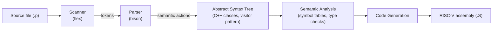

# Compiler Construction — From Scanner to RISC-V Code Generator


A compiler built incrementally over five assignments in a compiler course (Fall 2024). Each assignment adds the next compiler stage, taking source code all the way from raw characters to **RISC-V assembly**.

The compiler accepts the course's **Pascal-like teaching language** (source files use the `.p` extension): programs with global and local variables and constants (`integer`, `real`, `string`, `boolean`, multi-dimensional arrays), functions with parameters and return types, `begin … end` blocks, `if / else`, `while` and `for` loops, `read` / `print`, and arithmetic, relational and logical operators.

---

## Compiler Pipeline



## Assignments

| # | Stage | What was implemented |
| --- | --- | --- |
| HW1 | Lexical analysis | A **flex** scanner: keywords, identifiers, decimal / octal / floating-point / scientific literals, strings with `""` escapes, `//` and `/* */` comments (using exclusive start conditions), and `//&S±` / `//&T±` pseudocomments that toggle source and token listing |
| HW2 | Syntax analysis | A **bison** grammar for the whole language; the scanner returns tokens to the parser |
| HW3 | AST construction | Semantic actions that build an **abstract syntax tree** of C++ node classes, plus `visitChildNodes()` support so the visitor-based AST dumper (`--dump-ast`) can traverse it; unary minus precedence handled with `%prec` |
| HW4 | Semantic analysis | A visitor that builds **scoped symbol tables** and reports semantic errors (see below); a new `//&D±` pseudocomment toggles symbol-table dumps |
| HW5 | Code generation | A visitor that translates the AST into **RISC-V assembly** (see below) |

### HW4 — semantic checks

The analyzer keeps one symbol table per scope (program, function, compound statement, `for` loop) with entries of kind program, function, parameter, variable, loop variable or constant, and prints each table when its scope closes. It reports:

- **Declarations:** redeclared symbols (including loop variables redeclared in nested scopes) and array dimensions that are not greater than 0
- **References:** undeclared symbols, use of a non-variable symbol as a variable, non-integer array indices, and more subscripts than the array has dimensions
- **Expressions:** invalid operand types for binary and unary operators
- **Function calls:** calling a non-function symbol, wrong number of arguments, incompatible argument types
- **Statements:** `print` / `read` of non-scalar values, `read` into a constant or loop variable, array assignment, assignment to a constant or to a loop variable inside its loop, incompatible assignment types, non-boolean `if` / `while` conditions, `for` bounds that are not in increasing order, returning a value from the program or a procedure, and return-type mismatches

### HW5 — code generation

- **Stack-machine style evaluation:** every expression pushes its result onto the runtime stack; operators pop their operands into `t0` / `t1`, compute, and push the result. Comparisons are lowered to conditional branches that push `1` or `0`.
- **Functions:** each function gets a 128-byte frame with `s0` as the frame pointer and `ra` / `s0` saved in the frame. Arguments are passed in `s1`, `s2`, … and stored into the callee's frame on entry; the return value is returned in `a0`. Recursion is supported.
- **Variables:** globals are emitted as `.comm` symbols and global constants as `.word` data; locals, local constants, loop variables and parameters live at fixed offsets from `s0`.
- **Strings:** a first pass over the AST collects all string literals into `.rodata` labels (`S0`, `S1`, …) so they can be referenced from any scope.
- **Control flow:** `if / else`, `while` and `for` are lowered to labelled basic blocks, with a separate counter per construct so nested statements get unique labels.
- **Arrays:** multi-dimensional element addresses are computed in row-major order; arrays are passed to functions by base address.
- **I/O:** `print` and `read` call the runtime functions `printInt`, `printString` and `readInt`.

HW5 does not reuse the HW4 semantic analyzer: it is built on a separate front end (parser, AST and a symbol table with typed `SymbolEntry::KindEnum` entries), to which a `lookupdist()` helper was added for computing stack offsets. The code generator is in `hw5/src/lib/codegen/CodeGenerator.cpp`.

### Example

Input (`fact.p`):

```pascal
fact;

factorial(n: integer): integer
begin
    if n <= 1 then
    begin
        return 1;
    end
    else
    begin
        return n * factorial(n - 1);
    end
    end if
end
end

begin
    var result: integer;
    result := factorial(5);
    print result;
end
end
```

Output of `./compiler fact.p --save-path .` (excerpt from `fact.S`; `...` marks omitted lines):

```asm
factorial:
    addi sp, sp, -128
    sw ra, 124(sp)
    sw s0, 120(sp)
    addi s0, sp, 128
    sw s1, -12(s0)
    ...
if_end_1:
    addi t0, s0, -12
    addi sp, sp, -4
    lw t1, 0(t0)
    sw t1, 0(sp)     # push the value to the stack
    ...
    sub t0, t1, t0
    addi sp, sp, -4
    sw t0, 0(sp)     # push the value to the stack
    lw s1, 0(sp)     # load param value from stack
    addi sp, sp, 4
    jal ra, factorial
    addi sp, sp, -4
    sw a0, 0(sp)
    lw t0, 0(sp)     # pop the val2 from the stack
    addi sp, sp, 4
    lw t1, 0(sp)     # pop the val1 from the stack
    addi sp, sp, 4
    mul t0, t1, t0
    addi sp, sp, -4
    sw t0, 0(sp)     # push the value to the stack
    lw a0, 0(sp)     # return value
    addi sp, sp, 4
if_else_end_1:
    lw ra, 124(sp)
    lw s0, 120(sp)
    addi sp, sp, 128
    jr ra
```

---

## Getting Started

**Requirements:** `make`, `gcc` / `g++`, **flex** and **bison**, plus their runtime libraries (`-lfl`, `-ly`; on Ubuntu: `sudo apt install build-essential flex libfl-dev bison libbison-dev`).

Each assignment builds on its own:

| Assignment | Build | Run |
| --- | --- | --- |
| HW1 | `cd hw1/src && make` | `./scanner <file.p>` — prints the token stream and source lines |
| HW2 | `cd hw2/src && make` | `./parser <file.p>` |
| HW3 | `cd hw3/src && make` | `./parser <file.p> --dump-ast` |
| HW4 | `cd hw4/src && make` | `./parser <file.p> [--dump-ast]` — prints symbol tables and semantic errors |
| HW5 | `cd hw5/src && make` | `./compiler <file.p> --save-path <output_dir>` — writes `<output_dir>/<file>.S` |

`make clean` removes the generated scanner/parser sources and object files.

The generated assembly calls `printInt`, `printString` and `readInt`, which come from the course's runtime and are not included in this repository.

## Repository Structure

```
Compiler-f24_HW/
├── hw1/src/      # scanner.l, Makefile
├── hw2/src/      # scanner.l, parser.y, Makefile
├── hw3/src/      # + AST node classes (include/AST, lib/AST), visitor, AST dumper
├── hw4/src/      # + semantic analyzer and symbol tables (include/sema, lib/sema)
├── hw5/src/      # + RISC-V code generator (include/codegen, lib/codegen)
└── hwN/report/   # Write-up for each assignment (README.md)
```

## Tech Stack

- **Lexer generator:** flex
- **Parser generator:** bison
- **Implementation language:** C (HW1–HW2), C++14 (HW3–HW5)
- **Target architecture:** RISC-V (RV32, `sw` / `lw` 32-bit words)

---

## Author

**Ricky Chou** · [@RickyChou030](https://github.com/RickyChou030)
