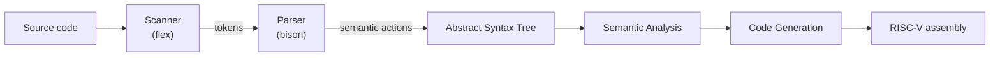

# Compiler Construction — From Scanner to RISC-V Code Generator


A complete compiler built incrementally over five assignments in a compiler course (Fall 2024). Each assignment extends the previous one, taking source code all the way from raw characters to **RISC-V assembly**.

<!-- TODO: name the source language the compiler accepts, e.g. "compiles a Pascal-like teaching language" -->

---

## Compiler Pipeline



## Assignments

| # | Stage | What was implemented |
| --- | --- | --- |
| HW1 | Lexical analysis | A scanner written with **flex** that converts source text into tokens |
| HW2 | Syntax analysis | A parser written with **bison** that checks the program against the language grammar |
| HW3 | AST construction | Semantic actions in the parser that build an **abstract syntax tree** |
| HW4 | Semantic analysis | Checks performed on the AST to detect semantic errors <!-- TODO: e.g. symbol tables, scope rules, type checking --> |
| HW5 | Code generation | Translation of the AST into **RISC-V assembly** |

<!-- TODO: add a short example: a few lines of source code and the RISC-V assembly your compiler produces -->

---

## Repository Structure

```
Compiler-f24_HW/
├── hw1/
│   ├── src/      # Source code
│   └── report/   # Assignment report
├── hw2/
├── hw3/
├── hw4/
└── hw5/          # Final compiler with code generation
```

Every `hwN/` directory has the same layout: source code in `src/` and the write-up in `report/`.

<!-- TODO: add build and run instructions, e.g. `cd hw5/src && make` and how to run the generated assembly (simulator used) -->

## Tech Stack

- **Lexer generator:** flex (lex)
- **Parser generator:** bison (yacc)
- **Target architecture:** RISC-V

---

## Author

**Ricky Chou** · [@RickyChou030](https://github.com/RickyChou030)
